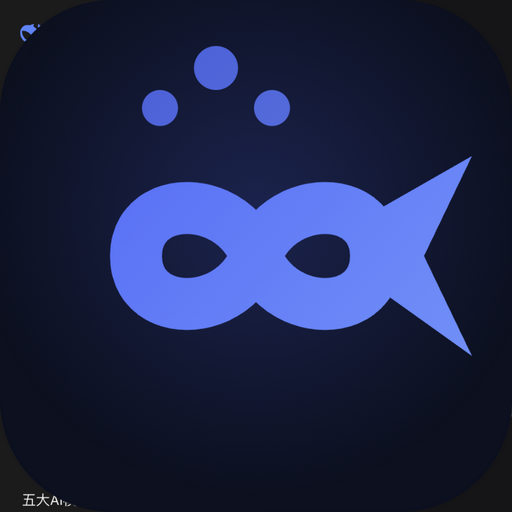
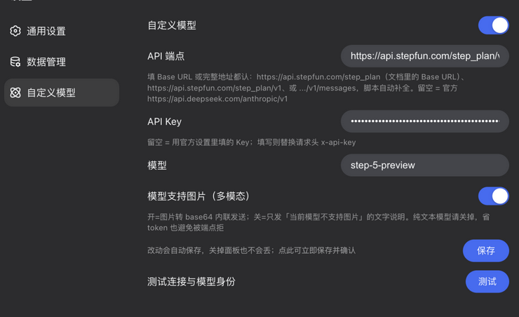
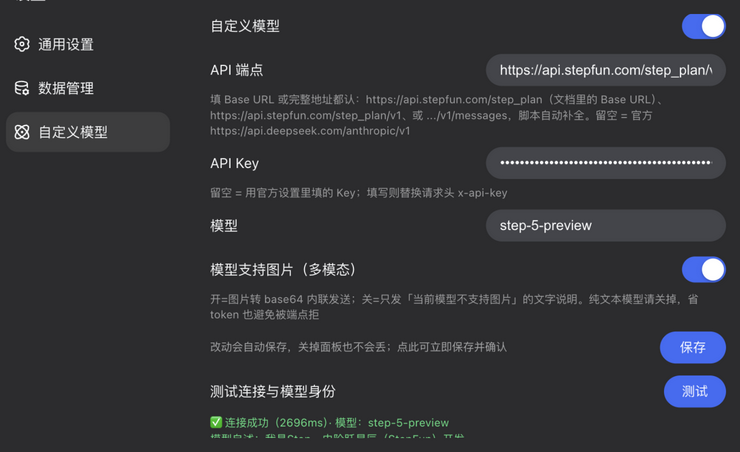
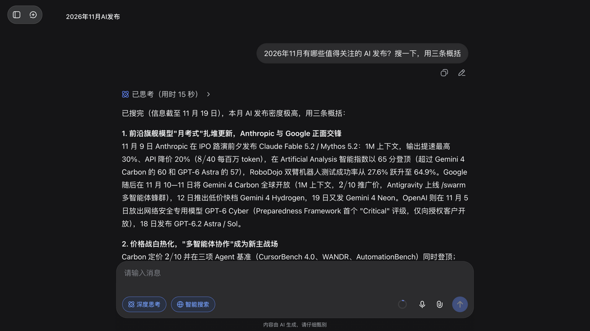
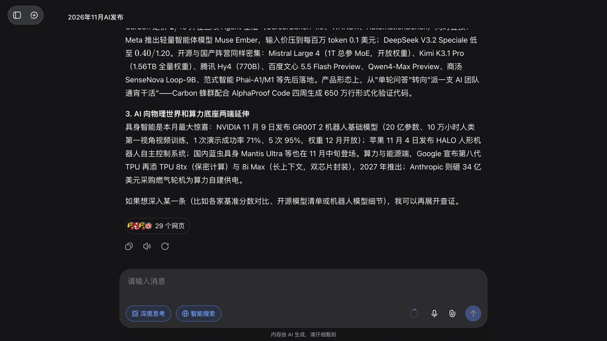

<p align="center">
  
</p>

<h1 align="center">DeepSeek 不限流</h1>

<p align="center">
  在 DeepSeek 官方的 chat-demo 页面里用你自己的 API Key：任意 Anthropic 兼容模型，<br>
  没有每日额度上限、没有 7 天不活跃断连、没有单次 4 万字输入限制。
</p>

<p align="center">
  
  
  
  
  
</p>

> 2026-11-16 起，DeepSeek 因算力紧张对 **C 端免费用户**实施限额：超 7 天不活跃的长对话不能续、单次输入从 8 万字砍到 **4 万字**、每日对话额度触顶后只回「服务器繁忙，使用额度已达上限」——相关话题连续登上热搜。
>
> 限额只针对 App 和网页版的免费额度，**开发者 API 一直不受限**。这个脚本做的就是把那条路接到官方 demo 页上：用自己的 Key，走官方开放接口。

---

**目录**：[能力](#能力) · [截图](#截图) · [安装](#安装) · [配置项](#配置项) · [三个选项怎么选](#三个选项怎么选) · [兼容性](#兼容性) · [隐私与安全](#隐私与安全) · [边界](#边界) · [开发](#开发)

---

## 能力

| 能力 | 说明 |
|---|---|
| **任意模型** | 端点 / Key / 模型名三项覆盖；Base URL、`/v1`、完整 `/messages` 地址都认，脚本自动补全 |
| **原生形状的搜索** | 第三方端点不认识 DeepSeek 的服务端工具，脚本把它拆成独立的「搜索腿」执行，结果按官方形状渲染，含「N 个网页」来源面板 |
| **两种搜索计费** | `native` = DeepSeek 模型驱动搜索（含模型 token 费）；`searchapi` = 直调搜索 API，只按次付费、不经模型 |
| **搜索参数全透传** | `count`(1~50，条数不影响费用) / `need_content`(带回网页正文) / `ori_question`(原始问题，改善意图理解)，以及 `site:` `lang:` `after:` `before:` 全套搜索语法 |
| **会话自动起名** | 官方端点起名腿 / 自定义模型起名 / 关掉，三选一 |
| **图片与文件** | 文本文件内联；图片转 base64 内联；可按模型是否多模态分别处理 |
| **上下文占用环** | 输入框旁实时显示 占用/窗口 百分比，悬浮面板给构成占比与缓存命中率（总量与命中率取自接口 usage，是精确值） |
| **其它** | 会话搜索、粘贴长文本自动转 txt、标签页标题跟随会话名、左上角官方标识 |

## 截图

| | |
|---|---|
|  |  |
| **自定义模型**：端点 / Key / 模型名三项覆盖，多模态单独开关 | **测试连接**：一键验证端点、Key 与模型身份 |
|  |  |
| **思考 + 搜索**：思考过程可折叠，搜索结论带引用 | **来源面板**：「N 个网页」按官方形状渲染 |
|  |  |
| **上下文占用环**：占用/窗口实时百分比 + 构成占比 | **一次完整交换**：消息、工具、来源同屏 |

## 安装

| 安装源 | 适合谁 | 链接 |
|---|---|---|
| GitHub Raw（默认） | 始终要最新版 | [deepseek-unlimited.user.js](https://raw.githubusercontent.com/dongyu23/deepseek-unlimited/main/deepseek-unlimited.user.js) |
| jsDelivr CDN | 访问 GitHub 慢 | [deepseek-unlimited.user.js](https://cdn.jsdelivr.net/gh/dongyu23/deepseek-unlimited@main/deepseek-unlimited.user.js) |
| Releases | 想固定版本 | [releases](https://github.com/dongyu23/deepseek-unlimited/releases)（暂未发布，先用上面两个） |

1. 装 [Tampermonkey](https://www.tampermonkey.com/)
2. 点上面任一链接完成安装
3. 打开 [chat-demo](https://cdn.deepseek.com/chat-demo) → 左下角 **设置** → **自定义模型** → 填端点 / Key / 模型名，打开总开关

设置改动即时生效并自动保存；「测试」按钮可一键验证端点连通性与模型身份。

**注意事项**

- 脚本只作用于 `https://cdn.deepseek.com/chat-demo`，不影响官网其它页面。
- **搜索腿和起名腿用的是页面自己设置里填的那把官方 Key**，不是你配的第三方 Key。demo 页要能搜索，得先在页面左上角「设置」里填好官方 API Key；没填时主对话照常，只是搜索/起名会失败。
- 不依赖 `GM_xmlhttpRequest`，没有油猴能力的环境（WebView / 内嵌浏览器注入）会自动改用 localStorage 存配置。

### 配置项

| 项 | 说明 |
|---|---|
| API 端点 | Base URL 或完整地址；留空 = 官方 `api.deepseek.com/anthropic/v1` |
| API Key | 第三方端点必填；只有精确官方 `api.deepseek.com` 端点可留空并使用页面官方 Key |
| 模型 | 留空 = 官方默认 |
| 多模态 | 开 = 图片转 base64 内联；关 = 只发「当前模型不支持图片」的文字说明 |
| 工具调用方式 | `native` / `searchapi`，**同时决定了搜索来源**（见下） |
| 上下文窗口 | 占用环百分比的分母，支持 `128000` / `128k` / `1m` |
| 工具桥接 | `auto`（端点非 deepseek 即启用）/ `on` / `off`，翻译层总闸 |
| 起名来源 | `deepseek` / `model` / `off`（见下） |

## 三个选项怎么选

「搜索来源」没有单独的开关——它由**工具调用方式**决定，所以下面按三件事讲清楚：搜索谁去干、标题谁起、翻译层开不开。

### ① 工具调用方式 = 搜索谁去干、怎么计费

第三方端点不认识 DeepSeek 的服务端工具（`web_search` / `read_url`），脚本就把搜索拆成一条独立的「搜索腿」替它干。这条腿有两种跑法：

| 模式 | 搜索来源 | 具体过程 | 你付什么 |
|---|---|---|---|
| `native`（默认） | DeepSeek 官方模型 | 搜索结果先喂回 DeepSeek 模型，由它读一遍、整理成带引用的结论，再把结论作为工具结果转给你的模型 | 模型 token 费 + 搜索费 |
| `searchapi` | DeepSeek 官方搜索 API | 不经过 DeepSeek 模型，直接调搜索接口拿结果，作为工具结果回给你的模型，由它写出回答 | 只有搜索费（按次计费，空结果不计费） |

**怎么选**

- **想省钱** → `searchapi`。一次搜索就是一次接口调用，`count` 要 10 条还是 50 条，价钱一样。
- **想更接近官网体验**（引用更准、结论被「读过」再进模型）→ `native`，代价是每轮搜索多一次模型调用。
- 输入框上的「智能搜索」开关照旧管事：关掉就完全不搜索，两种模式都不触发。

> 两种模式下，**搜索都走 DeepSeek 官方搜索服务**（用页面里自带的那把 Key），不是你配的第三方 Key——所以「换了模型」不等于「换了搜索引擎」。

### ② 起名来源 = 侧边栏那个会话标题是谁起的

| 模式 | 谁起名 | 代价与特点 |
|---|---|---|
| `deepseek`（默认） | DeepSeek 官方端点 | 走官方同一条 `title:{enabled:true}` 通道，服务端在流式响应的 `message_delta` 里把标题带回来。约 55 in / 16 out token（≈$0.001），与主回答**并行**发起，延迟被主回答盖住，基本无感 |
| `model` | 你配的第三方模型 | 拿首条用户消息让模型按规则返回一个 JSON 标题（≤12 汉字或 6 英文单词）。省掉官方腿那次调用，标题质量取决于所选模型 |
| `off` | 不起名 | 用首条消息截断当标题，零成本、零请求 |

**怎么选**：不在意这一厘钱就用默认 `deepseek`（标题最稳）；想完全只用自己的 Key 就 `model`；嫌打扰就 `off`。

### ③ 工具桥接 = 整个「翻译层」的总闸

前面两条腿都长在桥接上。桥接负责把官方形状的请求改写成第三方端点认的形状，再把第三方的响应翻译回官方形状（否则 demo 页解析不了，搜索面板、思考块、占用环全都不工作）。

| 模式 | 行为 |
|---|---|
| `auto`（默认） | 端点填了非 deepseek.com 的地址就启用；填官方地址或留空则完全透传（那时工具原生工作，不需要翻译） |
| `on` | 强制启用 |
| `off` | 关掉。自定义模型仍然生效，但搜索/起名/思考块等依赖官方形状的功能会失效 |

**什么时候要动它**：基本不用动，留 `auto` 就行——它会自己判断该不该翻译。只有确认端点确实支持服务端工具、又发现搜索腿在帮倒忙时，才需要 `off`。

## 兼容性

| 环境 | 状态 |
|---|---|
| Chrome / Edge / Comet + Tampermonkey 4.x+ | ✅ 日常使用 |
| 无油猴能力的注入方式（WebView / 内嵌浏览器） | ✅ 实测：自动回退 localStorage 存配置，功能完整 |
| 只依赖 `@match` 与 `GM_*`（不用 `GM_xmlhttpRequest`） | ✅ 跨管理器干扰最小 |
| Greasemonkey / 手机浏览器 / 其它管理器 | ⚠️ 未实测 |

## 隐私与安全

- **API Key 只存在你自己浏览器的本地存储**（油猴 `GM_*` 或 `localStorage`）。脚本不发送任何遥测，除了「你配置的端点」和「DeepSeek 官方接口」不连接任何服务器。
- 请求去向：主对话 → 你配置的端点；搜索腿 / 起名腿 → `api.deepseek.com`（用页面自带的官方 Key）。
- **安全边界**：官方 DeepSeek Key 只会发送到精确的 `api.deepseek.com`。第三方端点必须填写独立 Key；留空会被拒绝，不会静默回退官方 Key。
- 想彻底清除：在 **自定义模型** 里清空「API Key」一栏即可，改动立即落盘。
- 本仓库不含任何密钥；README 截图中的 Key 均为掩码。

## 边界

- **这不是破解**。没有任何绕过鉴权或伪造额度的行为，走的是 DeepSeek 官方开放接口，用你自己的 Key。
- 模型质量与额度取决于你选的服务商；脚本只负责让 demo 页「说上话」。
- 工具块不会被服务端清洗，连续搜索时上下文涨得比官网快（官网由 DeepSeek 服务端自清洗）。
- 刷新页面无法续传未完成的生成（官方站可以）。

## 开发

```bash
node build.js     # 拼接 src/ → deepseek-unlimited.user.js（约 180KB）
```

- `src/core/` — 配置 / 选择器 / 工具 / i18n
- `src/modules/` — 请求改写与设置面板、工具桥接、占用环、会话搜索、粘贴转 txt、标签页标题、工具条定位
- `src/assets/official-logo.svg` — 左上角官方标识（构建时内联）
- `docs/logo.png` — 项目标识（512×512，README 与脚本 `@icon` 都用它）

问题与建议请开 [Issue](https://github.com/dongyu23/deepseek-unlimited/issues)。

## License

MIT
