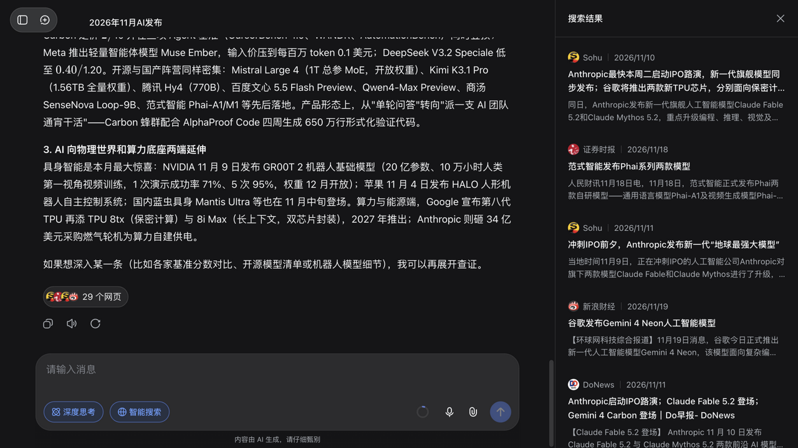
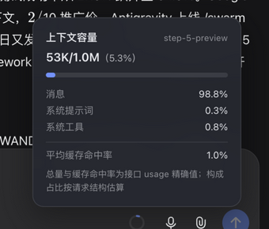

# DeepSeek 不限流

> 在 DeepSeek 官方的 chat-demo 页面里填上你自己的 API Key：**任意 Anthropic 兼容模型**，没有每日额度上限、没有 7 天不活跃断连、没有单次 4 万字输入限制。搜索、起名、思考、图片、上下文占用环，全部保留官网体验。

2026-11-16 起，DeepSeek 因算力紧张对 **C 端免费用户**实施限额：超 7 天不活跃的长对话不能续、单次输入从 8 万字砍到 **4 万字**、每日对话额度触顶后只回「服务器繁忙，使用额度已达上限」——相关话题连续登上热搜。

限额只针对 App 和网页版的免费额度，**开发者 API 一直不受限**。这个脚本做的就是把那条路接到官方 demo 页上：用自己的 Key，走官方开放接口。

---

## 截图

| | |
|---|---|
|  |  |
| **自定义模型**：端点 / Key / 模型名三项覆盖，多模态单独开关 | **测试连接**：一键验证端点、Key 与模型身份 |
|  |  |
| **思考 + 搜索**：思考过程可折叠，搜索结论带引用 | **来源面板**：「N 个网页」按官方形状渲染 |
|  |  |
| **上下文占用环**：占用/窗口实时百分比 + 构成占比 | **一次完整交换**：消息、工具、来源同屏 |

---

## 能力

| 能力 | 说明 |
|---|---|
| **任意模型** | 端点 / Key / 模型名三项覆盖；Base URL、`/v1`、完整 `/messages` 地址都认，脚本自动补全 |
| **原生形状的搜索** | 第三方端点不认识 DeepSeek 的服务端工具，脚本把它拆成独立的「搜索腿」执行，结果按官方形状渲染，含「N 个网页」来源面板 |
| **两种搜索计费** | `native` = DeepSeek 模型驱动搜索（含模型 token 费）；`searchapi` = 直调搜索 API，只按次付费、不经模型 |
| **搜索参数全透传** | `count`(1~50，条数不影响费用) / `need_content`(带回网页正文) / `ori_question`(原始问题，改善意图理解)，以及 `site:` `lang:` `after:` `before:` 全套搜索语法 |
| **会话自动起名** | 官方端点起名腿 / 自定义模型起名 / 关掉，三选一 |
| **图片与文件** | 文本文件内联；图片转 base64 内联；可按模型是否多模态分别处理 |
| **上下文占用环** | 输入框旁实时显示 占用/窗口 百分比，悬浮面板给构成占比与缓存命中率（总量与命中率取自接口 usage，是精确值） |
| **其它** | 会话搜索、粘贴长文本自动转 txt、标签页标题跟随会话名、左上角官方标识 |

---

## 绕开的是哪三条

| 官网限制 | 这里 |
|---|---|
| 每日对话额度，触顶提示「服务器繁忙」 | 用量走你自己的 Key，按量计费 |
| 超 7 天不活跃的长对话不能接续 | 会话与附件都在浏览器本地，随时接着聊 |
| 单次输入约 4 万字上限 | 输入长度由你所选模型决定（多数第三方模型给到 128K~1M tokens） |

---

## 安装

1. 装 [Tampermonkey](https://www.tampermonkey.com/)
2. 安装 [deepseek-unlimited.user.js](https://raw.githubusercontent.com/dongyu23/deepseek-unlimited/main/deepseek-unlimited.user.js)
3. 打开 [chat-demo](https://cdn.deepseek.com/chat-demo) → 左下角 **设置** → **自定义模型** → 填端点 / Key / 模型名，打开总开关

设置改动即时生效并自动保存；「测试」按钮可一键验证端点连通性与模型身份。

### 配置项

| 项 | 说明 |
|---|---|
| API 端点 | Base URL 或完整地址；留空 = 官方 `api.deepseek.com/anthropic/v1` |
| API Key | 留空 = 用页面官方设置里填的那把；填写则替换请求头 |
| 模型 | 留空 = 官方默认 |
| 多模态 | 开 = 图片转 base64 内联；关 = 只发「当前模型不支持图片」的文字说明 |
| 工具调用方式 | `native` / `searchapi`（见上表） |
| 上下文窗口 | 占用环百分比的分母，支持 `128000` / `128k` / `1m` |
| 工具桥接 | `auto`（端点非 deepseek 即启用）/ `on` / `off` |
| 起名来源 | `deepseek`（官方端点起名腿）/ `model`（自定义模型起名）/ `off` |

---

## 边界

- **这不是破解**。没有任何绕过鉴权或伪造额度的行为，走的是 DeepSeek 官方开放接口，用你自己的 Key。
- 模型质量与额度取决于你选的服务商；脚本只负责让 demo 页「说上话」。
- 工具块不会被服务端清洗，连续搜索时上下文涨得比官网快（官网由 DeepSeek 服务端自清洗）。
- 刷新页面无法续传未完成的生成（官方站可以）。

---

## 开发

```bash
node build.js     # 拼接 src/ → deepseek-unlimited.user.js（约 149KB）
```

- `src/core/` — 配置 / 选择器 / 工具 / i18n
- `src/modules/` — 请求改写与设置面板、工具桥接、占用环、会话搜索、粘贴转 txt、标签页标题、工具条定位
- `src/assets/official-logo.svg` — 左上角官方标识（构建时内联）

## License

MIT
